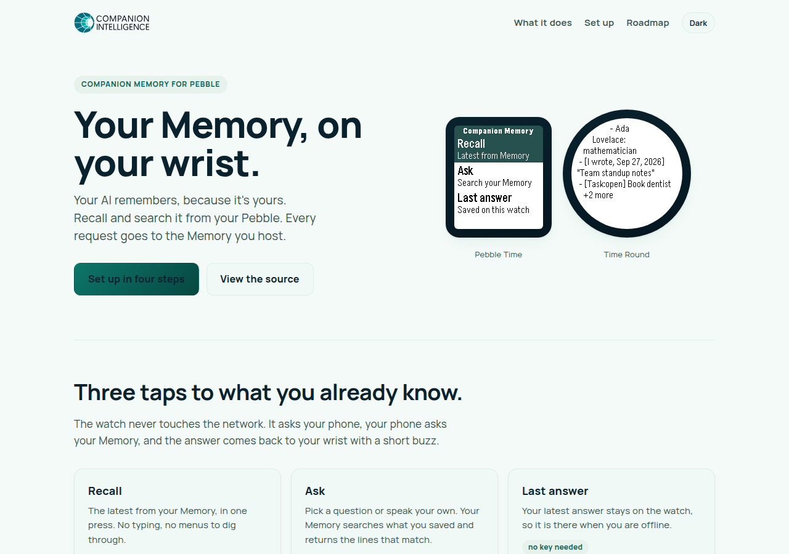
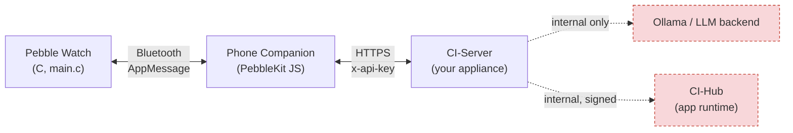
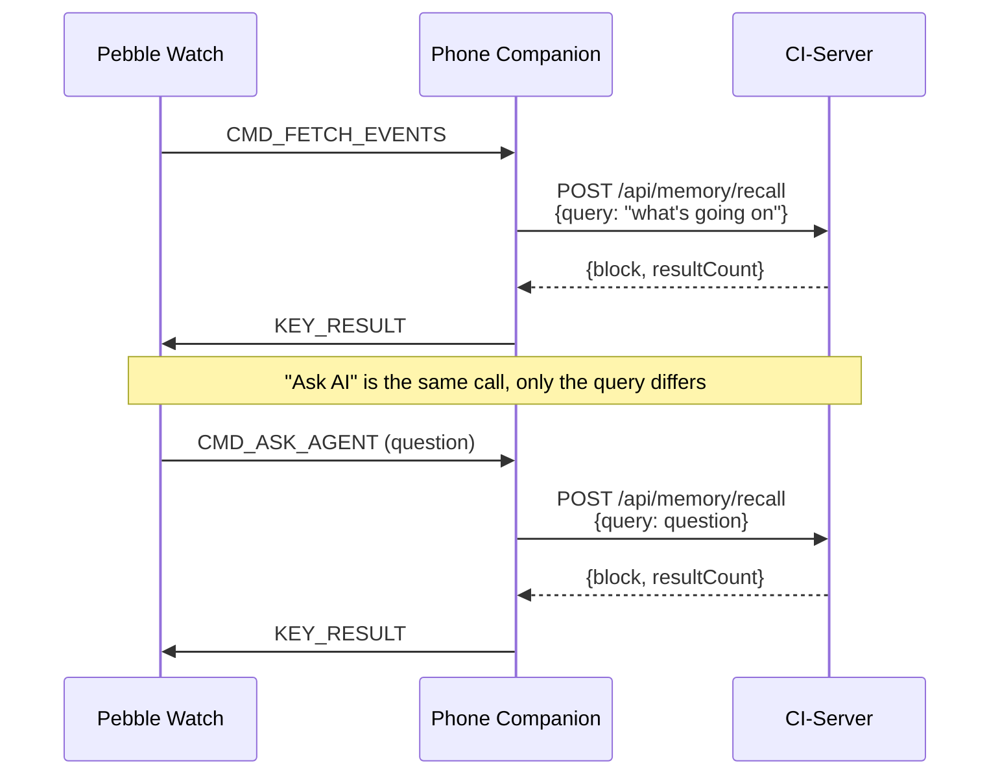
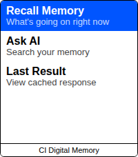
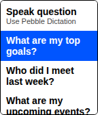
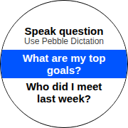
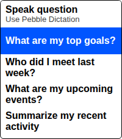
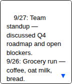
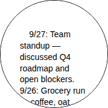
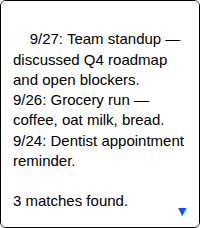

# Companion Pebble

Companion Pebble smartwatch app that acts as a wearable interface for the
[Companion Intelligence (CI) Digital Memory server](https://github.com/companionintelligence/CI-Server)
(CI-Server).

> **Looking for the connection audit?** See
> [`docs/CI-Integration-Audit.md`](docs/CI-Integration-Audit.md) for a
> ground-truth comparison of what this app calls against CI-Server's real
> API, and what changed.



The setup page above is live at [pebble.ci.computer](https://pebble.ci.computer)
(source in [`site/`](site/)).

---

## Architecture



All heavy processing happens off the watch. The watch UI sends small
AppMessage packets over Bluetooth to the phone companion, which makes a
single authenticated HTTPS call to CI-Server, then relays the result back
to the watch. The dashed red boxes are never reached by this app directly —
they're CI-Server's own concern.

**CI-Server is the only service this app talks to.** Two things it
deliberately never does, both covered in the audit doc:

- **It never calls Ollama directly.** Ollama is CI-Server's own internal LLM
  backend (or an OpenAI-compatible endpoint CI-Server is configured to use
  instead) — CI-Server owns model selection, tool-calling, and conversation
  state. A watch companion has no business holding a second, unauthenticated
  connection straight into that backend.
- **It never calls CI-Hub.** CI-Hub is the appliance's local app runtime for
  installed marketplace apps; CI-Server-to-Hub traffic is internal,
  signed service-to-service messaging (used e.g. to wake an installed
  agent app), not a surface external device clients are meant to reach.

### Data-flow sequence



`Recall Memory` and `Ask AI` are the same CI-Server call
(`POST /api/memory/recall`) with a different `query` string: a fixed
"what's going on" prompt for Recall Memory, the user's typed/dictated
question for Ask AI. Both return a markdown block of **retrieved** memory
content — a semantic search result, not a generated conversational
answer. See the audit doc for why.

---

## Project structure

```
CI-Pebble/
├── appinfo.json          # Pebble app metadata, AppMessage key definitions
├── wscript               # Pebble SDK (WAF) build script
├── src/
│   ├── c/
│   │   └── main.c        # Watch C app – UI, AppMessage, persistent storage
│   └── js/
│       └── pebble-js-app.js  # Phone companion – CI-Server calls
├── site/                 # Static Cloudflare Pages site for pebble.ci.computer
├── assets/
│   └── appstore/         # Icon + per-platform screenshots for the Rebble listing
├── docs/
│   ├── CI-Integration-Audit.md
│   ├── appstore-listing.md
│   └── screenshots/      # Screenshot of the pebble.ci.computer site itself
└── README.md
```

---

## Screenshots

The setup page screenshot above is real (captured from the live deployment).
The watch UI screenshots below are **accurate mockups built from `main.c`'s
actual menu strings and layout** (row text, row order, status bar) —
not real emulator captures, since this environment has no Pebble SDK or
emulator to produce those. They're faithful enough to use as-is (including
for the appstore listing — see [Publishing to the appstore](#publishing-to-the-appstore)),
but if you want pixel-perfect device captures instead:

1. In [CloudPebble](https://cloudpebble.repebble.com/), open this project
   and use **Compile → Run in emulator** (pick a platform).
2. Click through **Recall Memory**, **Ask AI**, and **Last Result** in the
   emulator.
3. Use the emulator's built-in screenshot button and overwrite the
   matching file under `assets/appstore/screenshots/`.

| Basalt | Chalk (round) | Emery |
|---|---|---|
|  |  |  |
|  |  |  |
|  |  |  |

Aplite (black & white) screenshots are also in
[`assets/appstore/screenshots/`](assets/appstore/screenshots/); Diorite
reuses the Basalt set (identical 144×168 color panel).

---

## Features

| Feature | Description |
|---|---|
| **Recall Memory** | Calls `POST /api/memory/recall` with a fixed prompt and shows the returned memory summary on the watch |
| **Ask AI** | Presents predefined questions and, on microphone-equipped watches, a Pebble Dictation option for ad-hoc questions — each one is sent to `POST /api/memory/recall` as the `query` |
| **Last Result** | Shows the last response cached in Pebble persistent storage (works offline) |
| **Configuration page** | Lets you set the CI-Server URL and API key from the Pebble phone app |
| **Passive sync** | Every 15 minutes, uploads a phone geolocation sample to `POST /api/position` when location permission is available. No step-count/health telemetry is sent — CI-Server has no live ingestion endpoint for it (bulk Apple Health / Google Fit import is a separate, unrelated CI-Server feature) |
| **Device registration** | Registers itself once as a CI-Server `smartwatch` device (`POST /api/devices`) and heartbeats it (`PATCH /api/devices/:id/last-seen`) so it shows up in the user's device list |
| **Status bar** | Shows transient status ("Loading…", "Thinking…", "Send failed") at the bottom of the main window |
| **Error handling** | Network errors, JSON parse failures, and AppMessage drops are all caught and reported gracefully |

**Not currently offered:** server-pushed notifications. CI-Server's
notification mechanism is Web Push (VAPID), which isn't something a
PebbleKit JS companion can subscribe to, and there is no pollable REST
feed to fall back to. See the audit doc's Open Gaps section before
re-adding this to the feature list.

---

## Requirements

| Component | Details |
|---|---|
| Pebble SDK | 3.x (any platform: Aplite, Basalt, Chalk, Diorite, Emery) |
| CI-Server | A running appliance exposing `POST /api/memory/recall`, `POST /api/devices`, and `POST /api/position` (all present on any current CI-Server build) |
| CI-Server API key | Created on CI-Server under Settings → API Keys with the **`memory`** scope enabled |
| Phone | Android (recommended) or iOS with HTTPS access to CI-Server |

Ollama and CI-Hub are **not** requirements from this app's point of view —
they're CI-Server's own concern (CI-Server talks to Ollama internally; it
has no dependency on CI-Hub at all for anything this app uses).

---

## Setup

### 1 – Install Pebble SDK

```bash
# Install the Pebble SDK and confirm the CLI works
pebble sdk install latest
pebble --version
```

### 2 – Get a CI-Server API key

Start (or use your existing) CI-Server appliance, then create an API key
with the `memory` scope from its Settings → API Keys screen. Verify the
appliance is reachable and the key works:

```bash
curl -X POST https://ci-server.local/api/memory/recall \
  -H "x-api-key: <your-api-key>" \
  -H "Content-Type: application/json" \
  -d '{"query": "what happened recently?", "maxResults": 3}'
```

A `{"block": "...", "resultCount": N}` response means you're set.

### 3 – Configure the phone companion

By default the companion uses:

| Setting | Default |
|---|---|
| CI-Server base URL | `https://ci-server.local` |

Open the Pebble phone app, tap the gear next to **CI Memory**, and save:

| Setting | Purpose |
|---|---|
| CI-Server URL | Base URL for memory recall, device registration, and position uploads |
| API key | Sent as `x-api-key` on every request; must carry the `memory` scope |

The same values can still be overridden from the Pebble app JavaScript console:

```js
localStorage.setItem('ci_host',   'https://192.168.1.100:8443');
localStorage.setItem('ci_api_key', '<your-api-key>');
```

### 4 – Build and install

```bash
pebble build
# Install on emulator for quick testing
pebble install --emulator basalt --logs

# Install on a real device (watch must be paired via Bluetooth)
pebble install --phone <PHONE_IP> --logs
```

If you're building in [CloudPebble](https://cloudpebble.repebble.com/)
instead of the local `pebble` CLI, the equivalent is the **Compile** tab,
then **Install** (real watch, needs the CloudPebble companion app on your
phone) or **Run in emulator**.

---

## Publishing to the appstore

The original Pebble appstore is gone; the community-run continuation is
[Rebble](https://rebble.io), and its submission surface is the
[Developer Portal](https://dev-portal.rebble.io/). Here's the real path,
not a guess at one:

1. **Get a clean build for every target platform.** `pebble build` (or
   CloudPebble's Compile tab) produces one `.pbw` that bundles all
   platforms declared in `appinfo.json`'s `targetPlatforms`
   (`aplite, basalt, chalk, diorite, emery`). Fix build errors before
   anything else — see Troubleshooting below for one that's already been
   hit and fixed in this repo.
2. **Set the app's launcher icon.** This app doesn't ship one in
   `appinfo.json`'s `resources.media` yet. Use
   [`assets/appstore/icon/icon-48.png`](assets/appstore/icon/icon-48.png)
   (or re-export [`icon-source.svg`](assets/appstore/icon/icon-source.svg)
   at another size) and upload it through CloudPebble's project
   **Settings** tab, which has a dedicated icon field and writes the
   correct `resources.media` entry for you — hand-editing that JSON risks
   the same kind of never-actually-compiled mistake the dictation status
   bug was (see the audit doc).
3. **Screenshots** — [`assets/appstore/screenshots/`](assets/appstore/screenshots/)
   already has a full set per platform (see [Screenshots](#screenshots)
   above); swap in real emulator captures first if you want those instead.
4. **Create the app listing** on the
   [Developer Portal](https://dev-portal.rebble.io/): name, description,
   category, the large ([`icon-144.png`](assets/appstore/icon/icon-144.png))
   and small ([`icon-48.png`](assets/appstore/icon/icon-48.png)) store
   icons, and your screenshots. **All the actual copy — description,
   category recommendation, hardware compatibility, privacy notes — is
   pre-written in [`docs/appstore-listing.md`](docs/appstore-listing.md),**
   field-mapped to what the portal asks for; it's meant to be copy-pasted,
   not re-derived.
5. **Upload the `.pbw`** as a release on that listing and submit for
   review, per Rebble's
   [publishing-an-app guide](https://developer.rebble.io/guides/appstore-publishing/publishing-an-app/).

None of this can be done from a repo push — it's a Developer Portal
web flow with your own Rebble account, by design (nobody but you should
be able to publish under your account).

---

## AppMessage keys

Defined in `appinfo.json` → `"appKeys"` and mirrored in both `main.c` and
`pebble-js-app.js`:

| Key | Value | Direction | Description |
|---|---|---|---|
| `KEY_COMMAND` | 0 | Watch → Phone | Numeric command code |
| `KEY_QUERY` | 1 | Watch → Phone | Optional text payload (question) |
| `KEY_RESULT` | 2 | Phone → Watch | Result string (max 252 chars) |
| `KEY_ERROR` | 3 | Phone → Watch | Error description |
| `KEY_STATUS` | 4 | Phone → Watch | Transient status text |

Command codes sent via `KEY_COMMAND`:

| Code | Name | Payload |
|---|---|---|
| 1 | `CMD_FETCH_EVENTS` | none |
| 2 | `CMD_ASK_AGENT` | Question string in `KEY_QUERY` |

---

## Security & Privacy

* All data stays on your own hardware (CI-Server is self-hosted).
* Use **HTTPS** for phone → CI-Server calls (required on iOS).
* The API key is stored in phone `localStorage`, sent only as the
  `x-api-key` header on requests to the CI-Server URL you configured —
  never anywhere else.
* Passive location samples are obtained from the paired phone only when the
  Pebble companion is active and are uploaded to your own CI-Server.
* This app never talks to Ollama or CI-Hub directly — see Architecture above.

---

## Troubleshooting

| Symptom | Fix |
|---|---|
| Build fails: `'DictationSessionStatusFailureTranscription' undeclared` | Fixed in this repo — the SDK's real enum value is `DictationSessionStatusFailureTranscriptionRejected` (`main.c`'s dictation callback). If you see this, pull latest; if you're diffing against an older copy, rename the identifier. |
| AppMessage NACK / outbox full | Only one message can be in-flight at a time. Wait for the previous send to complete before sending another. |
| Watch shows nothing after selecting a menu item | Check phone logs (`pebble logs`) for XHR errors. Confirm CI-Server URL and API key are correct. |
| "Parse error" on watch | Log `xhr.responseText` on the phone. The server may be returning HTML (error page) instead of JSON — usually a wrong CI-Server URL. |
| "Check API key/scope" on watch | The API key is missing, wrong, or lacks the `memory` scope. Recreate it on CI-Server under Settings → API Keys. |
| "Nothing relevant found in memory." | CI-Server's recall returned zero results for that query — not an error. Try a broader question. |
| iOS network calls fail | Ensure the CI-Server URL uses HTTPS. iOS only allows HTTPS or whitelisted domains. |
| Dictation is missing from the Ask AI menu | Pebble Dictation requires a microphone-equipped watch (Basalt/Chalk/Diorite/Emery). Aplite continues to show predefined questions only. |
| Passive location logs never appear on CI-Server | Confirm the phone granted location permission to the Pebble app; denied permission means the upload is skipped rather than sent empty. |
| "No cached result" on watch | The watch cache is populated only after the first successful fetch. Connect the phone and run "Recall Memory" first. |
