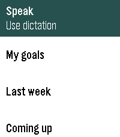
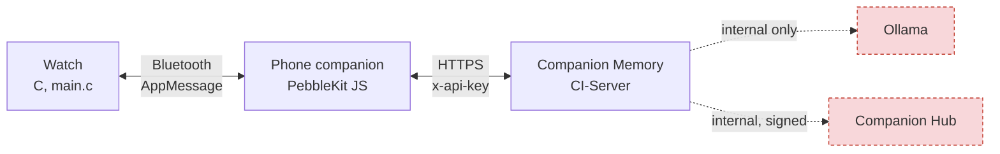
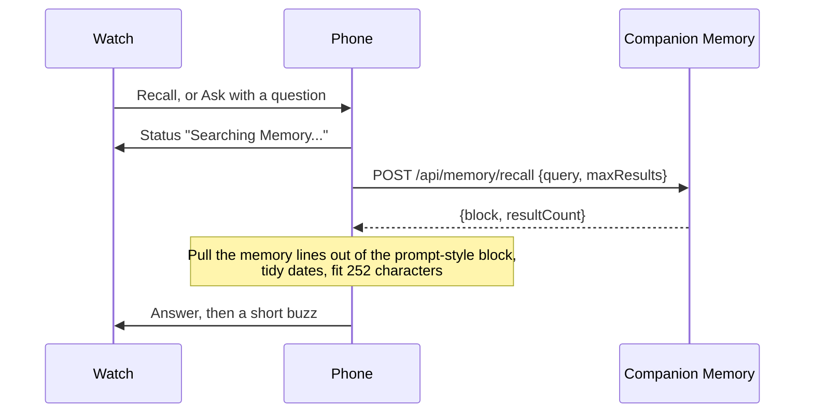

<div align="center">

<picture>
  <source media="(prefers-color-scheme: dark)" srcset="site/assets/brand/lockup.svg">
  
</picture>

<h1 align="center">Companion Memory for Pebble</h1>

<p align="center"><strong>Pebble smartwatch app that acts as a wearable interface for the Companion Intelligence (CI) Digital Memory server and the Ollama</strong></p>

<p align="center"><a href="https://pebble.ci.computer">Website</a></p>

<!-- BEGIN GENERATED tagline -->
**Your AI remembers, because it's yours.**
<!-- END GENERATED tagline -->

Recall and search your Companion Memory from your wrist. The watch asks your phone, your phone asks
the Memory you host, and the answer comes back with a short buzz.

[](docs/appstore-listing.md)
[](appinfo.json)
[](LICENSE.md)
[](https://pebble.ci.computer)

[**Set up in four steps**](#set-up-in-four-steps) &nbsp;·&nbsp;
[Roadmap](docs/ROADMAP.md) &nbsp;·&nbsp;
[Connection audit](docs/CI-Integration-Audit.md) &nbsp;·&nbsp;
[Store listing](docs/appstore-listing.md)

<br>

<table>
  <tr>
    <td align="center"><br><sub>Pebble Time</sub></td>
    <td align="center"><br><sub>Time Round</sub></td>
    <td align="center"><br><sub>Time 2</sub></td>
    <td align="center"><br><sub>Original Pebble, black and white</sub></td>
  </tr>
</table>

<sub>Every screenshot in this repository is captured from the real app on the Pebble emulator by <a href="scripts/emulator-shots.sh"><code>scripts/emulator-shots.sh</code></a>.</sub>

</div>

---

## What it does

| | |
|---|---|
| **Recall** | The latest from your Memory in one press. |
| **Ask** | Pick a question, or speak your own on watches with a microphone. Your Memory searches what you saved and returns the lines that match. |
| **Last answer** | Your most recent answer stays on the watch, so it is there offline. |
| **Connection check** | After you save settings, the phone tells you what works: Recall and Ask, watch registration, location sync. |
| **Location sync** | Off by default. Every 15 minutes it can send one location sample to your Memory. |

An answer buzzes the watch and appears as short bullet lines. Errors state a fact and a fix, for
example "Key rejected. Paste it again in settings."

## How it works



The watch never touches the network. The phone makes one authenticated call to your Memory and nothing
else. The dashed boxes are things your Memory talks to; this app never does.



Recall and Ask are the same server call with a different `query`. The answer is a search over
what you saved, not a generated reply. The reasons are in the [audit](docs/CI-Integration-Audit.md).

## Set up in four steps

**1. Create an API key.** In Companion Memory open Settings, API keys, and create one with the
`memory` scope. Check it from any terminal:

```bash
curl -X POST https://your-memory.example/api/memory/recall \
  -H "x-api-key: YOUR_KEY" -H "Content-Type: application/json" \
  -d '{"query": "what happened recently?", "maxResults": 3}'
```

**2. Build the watch app.** In [CloudPebble](https://cloudpebble.repebble.com/), import this repository
and press Compile. Or locally:

```bash
uv tool install pebble-tool
pebble sdk install latest
npm run build
```

**3. Install it.** Send the build to your watch from CloudPebble, or try it in the emulator first:
`pebble install --emulator basalt`.

**4. Connect your Memory.** In the Pebble phone app, open Companion Memory settings, enter your Memory
URL and the key, and save. The app checks the connection and lists what works.

### What each feature needs from the key

Companion Memory denies a scope-limited key on any route that does not name its scope
([`apiKeyScopeEnforcement.ts`](https://github.com/companionintelligence/CI-Server)). That is a good default, and it
decides what a key can do today:

| Feature | Key it needs |
|---|---|
| Recall, Ask | scope `memory` |
| Register this watch as a device | unrestricted key (device routes name no scope yet) |
| Location sync | unrestricted key (position routes name no scope yet) |
| Recorder (next) | scope `memory` with write capability |
| Planner (next) | scope `intents` |

The settings page says which of these your key can do, so nothing fails quietly.

## Privacy

- Requests go from your phone straight to the Memory URL you enter. No relay, no account, no analytics.
- The API key stays on your phone. The settings page is a local page, so the key never reaches a web server.
- Location sync is off until you switch it on, and it only ever goes to your Memory.
- **Speaking a question uses Pebble Dictation, which is a cloud speech service.** The audio goes to the
  speech service your Pebble platform uses, not to this app and not to your Memory. Picking a
  predefined question sends no audio anywhere.

## Development

```bash
npm test                 # 17 tests: the real companion running against a fake Pebble, XHR and storage
npm run build            # compile for every platform with the current SDK, into build/
npm run shots            # boot each emulator and capture real screenshots
npm run brand:check      # fail if a brand-derived file has drifted from the pinned canon
```

| Path | What lives there |
|---|---|
| `src/c/main.c` | Watch app: menus, dictation, answer window. Colours come from the generated `brand.h`. |
| `src/js/pebble-js-app.js` | Phone companion: CI-Server calls, connection check, settings page. |
| `appinfo.json`, `resources/` | Manifest (classic layout, so CloudPebble sync works) and the launcher icon. |
| `vendor/brand/` | The pinned, hash-checked subset of the CI-Common brand bundle. See `.brand-source`. |
| `scripts/sync-brand.mjs` | Writes every brand-derived file from `vendor/brand`. Nothing it writes is hand-edited. |
| `site-src/`, `site/` | Template and output for [pebble.ci.computer](https://pebble.ci.computer). |
| `assets/appstore/` | Store icons and real emulator screenshots. |
| `docs/` | [Roadmap](docs/ROADMAP.md), [connection audit](docs/CI-Integration-Audit.md), [store listing](docs/appstore-listing.md). |

**Brand.** Colors, type, logos and product copy come from [CI-Common](https://github.com/companionintelligence/CI-Common),
pinned to `@companionintelligence/tokens@1.0.0`. Change the pin with `scripts/vendor-brand.sh`, then run
`npm run brand:sync`. The design gate is `ci-lint-canon`; it currently passes with five non-blocking
warnings, all from the generated brand block in the companion.

**Builds.** The repository keeps the classic `appinfo.json` layout because CloudPebble's GitHub sync reads it.
`scripts/build-modern.sh` adapts it to the current SDK on the fly, with the SDK's own `-Werror` flags.

## Troubleshooting

| You see | Do this |
|---|---|
| "Key rejected. Paste it again in settings." | The key is missing, mistyped or revoked. Create a new one and paste it whole. |
| "Key can't do that. Give it the memory scope." | Recreate the key with the `memory` scope. |
| "Can't reach your Memory." | Check the URL. On iOS it must be HTTPS. |
| "Nothing found. Try a broader question." | Your Memory had no match. Not an error. |
| Settings say registration or location "needs an unrestricted key" | Expected with a scoped key. Recall and Ask still work. |
| No Speak row | Your watch has no microphone (original Pebble). Pick a predefined question. |
| Watch says "Phone unreachable" | Open the Pebble phone app and check the Bluetooth link. |

## Credits and license

Built on [Rebble](https://rebble.io) and the Pebble SDK. Brand, fonts and logos from CI-Common; Manrope and
JetBrains Mono are OFL licensed (`site/assets/brand/LICENSE-*.txt`). See [`CREDITS.md`](CREDITS.md),
[`NOTICE.md`](NOTICE.md) and [`LICENSE.md`](LICENSE.md). &copy; Lifescope Inc.
