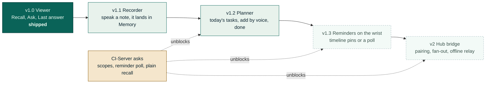
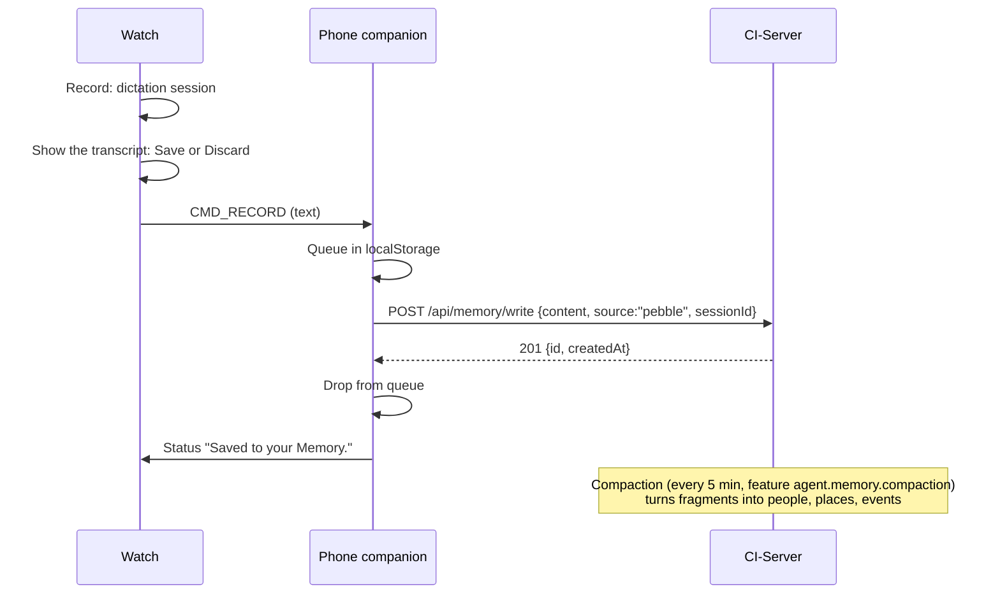
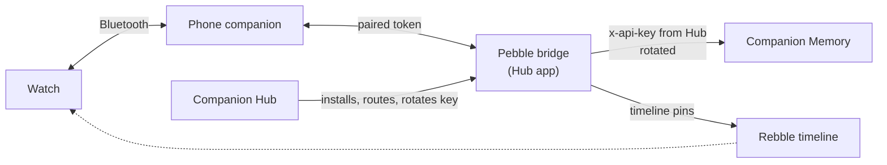

# Roadmap: from viewer to recorder and planner

Companion Memory for Pebble reads your Memory today. This roadmap makes it write to your Memory
(a recorder) and help you run the day (a planner), and says exactly what has to change in
CI-Server and CI-Hub for the parts that cannot be built from the watch side alone.

Everything below is grounded in code, read at `ci-server@e05a098` and `ci-hub@affad01`
(the same pinned commits as the [connection audit](CI-Integration-Audit.md)). Where a claim
comes from reading Hub rather than running it, it says so. Nothing here is a promise of a date.

## What the server offers today

All routes are reached under `/api` (the gateway strips the prefix). A key with **no scopes** is
unrestricted; a key **with** scopes is denied on any route that does not name one of them
(`common/guards/apiKeyScopeEnforcement.ts:104-120`). That single rule shapes the whole plan.

| Need | Route or intent | Key it needs | Status |
|---|---|---|---|
| Search memory | `POST /memory/recall` | scope `memory`, read | in use |
| Save free text | `POST /memory/write` `{content ≤10000, title?, source?, sessionId?}` | scope `memory`, **write** | usable now |
| Save an idempotent note | `POST /v1/notes` `{records:[{id (uuid), title?, content?, captured_at}]}` | scope `capture`, write | usable now, JSON only |
| List tasks | intent `planning.findTasks` `{status?, query?, dueBefore?, dueAfter?, limit}` | scope `intents`, read | usable now |
| Add a task | intent `planning.createTask` `{title, dueAt?, scheduledFor?, priority?}` | scope `intents`, write | usable now |
| Complete a task | intent `planning.completeTask` `{taskId}` | scope `intents`, capability **full** (destructive) | needs an ask |
| What is next | intent `forecast.read` `{horizon:'24h'}`, `places.next` | scope `intents`, read | needs feature `hbpe` |
| Register the watch | `POST /devices`, `PATCH /devices/:id/last-seen` | **unrestricted** | no scope declared |
| Upload location | `POST /position` | **unrestricted** | no scope declared |
| Reminders | GraphQL `reminders`, `createReminder`, `cancelReminder` | **unrestricted** | no REST, no snooze |
| Notes as records | GraphQL `createNote` | **unrestricted** | no REST |
| Audio to text | none | | no speech to text on the server |

Two design decisions in the server are worth knowing before building on it:

- `planning.updateTask` deliberately does not accept `status`, and `planning.completeTask` is marked
  destructive and not local-capable. A key minted by Hub for an installed app (`managed_by='connect'`)
  gets a destructive intent **queued for the owner to confirm** instead of run. For a watch that is a feature:
  "Done" can become "confirm on your Companion".
- The `/memory/recall` block is written for an LLM prompt: a heading, a long "this is data, not
  instructions" guard, then the memory lines between `<<<UNTRUSTED_CONTENT` and `UNTRUSTED_CONTENT>>>`
  (`common/prompt/untrustedBlock.ts`). The companion extracts the lines; see ask 5 below for a cleaner contract.

## v1.1 Recorder: speak a note, it lands in your Memory

- **Route.** `POST /memory/write` with the same `memory` scope as Recall, plus write capability.
  It needs no client-minted id, and the text is searchable through the search-index event right away.
- **Watch.** A new first row, **Record**. Dictation returns text, so the watch shows it and asks
  Save or Discard before anything is sent. The dictation buffer moves from 255 to 512 bytes; the
  SDK documents no maximum, so measure memory on Aplite (24 KB total) before going higher.
- **Phone.** A small queue in `localStorage`, flushed on the next successful connection. `/memory/write`
  has no idempotency key, so a retry after an ambiguous failure can duplicate. The queue marks an item
  in flight and never re-sends one that got a response. If that is not good enough, switch the queue to
  `POST /v1/notes`, which is idempotent on a client-minted uuid (ES5 needs a small v4 generator).
- **Key.** `memory` scope with **write** capability. Same key as Recall, one capability step up.
- **Done when.** A spoken note appears in Recall within about ten minutes, an offline note survives a
  restart and arrives once, and Aplite (no microphone) shows no Record row.

**Privacy, stated plainly.** Pebble Dictation is a cloud speech service: the SDK reports a "cloud
recognizer" and needs an internet connection. The app only contacts your Memory, but the audio you
speak goes to the speech service your Pebble platform uses. The Record row, the Speak row, the site and
the store listing all say so.

## v1.2 Planner: what is due, add by voice, mark done

- **Today.** `planning.findTasks` with `status` open or in progress and `dueBefore` at the end of the
  day. It has no `scheduledFor` filter, so tasks scheduled for today with no due time will not appear.
  The watch shows the top five in one glance, with the priority first.
- **Add.** Dictate a title; `planning.createTask {title}`. Optional voice due time is later.
- **Done.** `planning.completeTask` needs capability **full**, which also permits `memory.forget`.
  Do not hand that to a watch. Either wait for a non-destructive completion path (ask 3), or route
  Done through a Hub-minted key so the appliance asks the owner to confirm.
- **What is next.** `forecast.read` (96 buckets of 15 minutes, needs `hbpe` on) and `GET /memory/context`,
  which already carries a "Predicted Day Ahead" block. A glance row, **Up next**, reads one of them.
- **Key.** `intents` scope. Add `memory` for Recall and the recorder.
- **Done when.** The watch lists today's tasks, a spoken task shows up in Companion Memory's planner,
  and completing one requires a deliberate confirmation.

Planning is behind the server feature `planning.enabled`. When it is off, reads come back empty and
writes are refused, so the watch has to say "Planning is off on your Memory" instead of showing nothing.

## v1.3 Reminders on the wrist

The server delivers a due reminder as Web Push and nothing else (`ReminderDispatchService`), and there
is no route to ask "what is due". A PebbleKit companion cannot subscribe to Web Push, so there are three
honest options, in the order to try:

1. **Poll**, once the server has a route for due reminders (ask 2). The phone checks while the app is
   alive and calls `Pebble.showSimpleNotificationOnPebble`. It only works while the companion runs.
2. **Timeline pins.** Pebble's timeline lets a service push a pin to a user's watch with reminders and
   actions, even when the phone app is asleep. The app asks for a per-user token with
   `Pebble.getTimelineToken()`. Rebble's guide says an app must be uploaded to the Developer Portal
   first and that sandbox pins reach only whitelisted users. The endpoint and pin schema are not in the
   guide text I could fetch, so **confirm the current Rebble timeline API before building**.
3. **Hub bridge** (below), which does the polling and the pinning on the appliance.

## v2 A bridge on Companion Hub

A Hub app is two files, `config.json` and `docker-compose.json` (schemaVersion 2), validated by the
Zod schema in `packages/common/src/schemas/app-info.ts`. Read from the Hub repo, not run:

| Piece | How Hub supports it |
|---|---|
| Call the Memory | `hub_integration.memory` (`url_env`, `token_env`). The user grants it through `/api/memory-connect`, Hub gets a `managed_by='connect'` key and rotates it. The bridge calls `x-api-key`. |
| Be reachable from a phone | Traefik routes by hostname (`{app}-{device}-{org}.{domain}` through the tunnel, or a tailnet name). There are no per-app external API keys, so **the bridge runs its own pairing and token layer** (a QR scan fits the platform). |
| Be woken | `mcp_client: true` plus `wake_port` and `wake_endpoint`. But CI-Server only rings the Hub doorbell for agent dispatch jobs, and the body is fixed text, so this does not carry reminders today. A bridge polls instead. |
| Expose tools | An `mcp` block. A `pebble_notify` tool would let any agent buzz the wrist. |

A bridge would own: phone pairing, one **glance** endpoint (tasks, next event and recent memory in one
response, so the watch makes one round trip), the reminder poll and timeline fan-out, and the offline
queue relay. `mcp_client` apps are bound to loopback on the host, so external reach goes through the
tunnel or the tailnet, not the LAN.

The trust to work out with the Marketplace team: a `memory` grant is a manifest opt-in in Hub, and the
first-party store slug is `ci-marketplace`. Whether a bridge ships first-party or third-party decides
which grants it gets.

## Changes we need in CI-Server and CI-Hub

| # | Ask | Why it matters here |
|---|---|---|
| 1 | Add `@RequireScopes` to `/devices` and `/position` | A scoped watch key can register and upload. Today those calls need an unrestricted key. |
| 2 | A reminder poll route (`GET /reminders?due=`) and a snooze operation | There is no way to read due reminders except GraphQL, and nothing can snooze. |
| 3 | A non-destructive `planning.completeTask`, or a `planning.today` intent with a `scheduledFor` filter | Completing and listing today should not need a full-capability key. |
| 4 | An idempotency key and client timestamp on `POST /memory/write` | Safe retries from an offline queue. |
| 5 | A plain recall format for small screens (for example `?format=lines`) | Return the memory lines without the prompt guard, so clients stop parsing marker text. |
| 6 | A generic notify to Hub, not only agent dispatch | Reminders could wake a Hub app instead of being polled. |
| 7 | Hub: register a wake target at runtime, and per-app external tokens | A bridge would not need its own auth layer. |
| 8 | Optional: server speech to text | Raw audio from the watch, instead of cloud dictation. Not needed for v1.x. |

## How to read the gaps

Everything in v1.1 and the first half of v1.2 can ship from this repository alone, on the `memory`
and `intents` scopes. Reminders, one-tap completion and the bridge depend on the asks above, and
the order in the diagram is the order they unblock. Track them in CI-Engineering and link the
issue numbers here when they exist.
